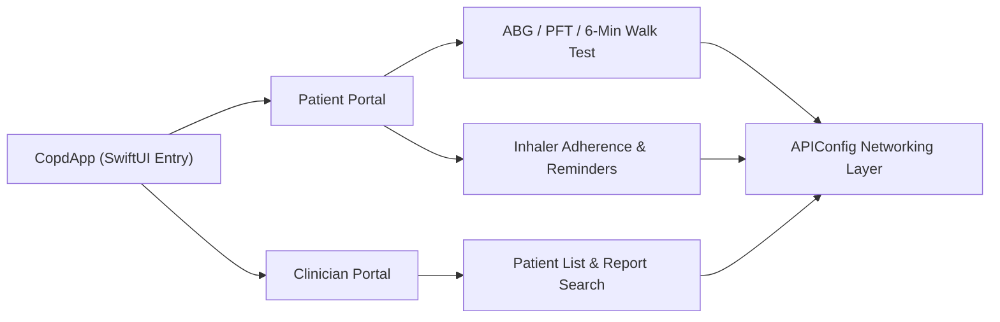

<div align="center">
  

  <h1>BreathTrack — COPD & Respiratory Care</h1>

  <p><b>Native iOS MedTech & telehealth respiratory companion built with SwiftUI featuring dual Doctor/Patient portals, ABG & PFT diagnostics, 6-Minute Walk Test tracking, and inhaler adherence workflows.</b></p>

  <a href="https://apps.apple.com/in/app/breathtrack/id6804558579">
    
  </a>
  
  
  
</div>

---

## 📱 App Preview

<div align="center">
  <table>
    <tr>
      <td></td>
      <td></td>
      <td></td>
      <td></td>
    </tr>
  </table>
</div>

---

## ✨ Key Capabilities

- **🩺 Clinical Respiratory Diagnostics**: Structured logging & review for **ABG Reports** (`ABGReport.swift`), **PFT Values** (`PftValues.swift`), and the **6-Minute Walk Test** (`SixMinWalkTestView.swift`).
- **💨 Inhaler & Medication Adherence**: Daily inhaler tracking (`InhalerAdherenceView.swift`), medication schedules (`Medication.swift`), and local reminders (`UserNotifications`).
- **👨‍⚕️ Dual Doctor & Patient Workflows**: Dedicated clinician dashboards (`Patientlist.swift`, `SearchPatientReportsView.swift`, `DoctorProfile.swift`) and patient appointment booking (`Appointmentform.swift`, `PatientAppointments.swift`).
- **🎥 Rehab Video & Media Uploads**: Integrated `PhotosUI` and `SafariServices` support for pulmonary rehabilitation content (`UploadVideos.swift`).
- **🎨 Unified Design System**: Modular tokens and reusable clinical cards defined in `DesignSystem.swift` across 47 Swift source files.

---

## 🏗️ Architecture



---

## 🛠️ Frameworks & Tech Stack

| Layer | Technologies |
| :--- | :--- |
| **UI & Design System** | `SwiftUI`, `UIKit`, `DesignSystem.swift` |
| **Media & Web** | `PhotosUI`, `SafariServices` |
| **Engagement** | `UserNotifications` (`Notifications.swift`) |
| **Networking** | `Foundation`, `APIConfig.swift` |

---

## 🚀 Getting Started

1. Clone the repository:
   ```bash
   git clone https://github.com/vishal-rao28/BreathTracker.Swift.git
   cd BreathTracker.Swift
   ```
2. Open the Xcode project:
   ```bash
   open Copd.xcodeproj
   ```
3. Select an iOS Simulator or physical iPhone and press **`Cmd + R`**.

---

## 👤 Author

**Vishal Rao M** — Native iOS & On-Device AI Architect  
[Live Portfolio](https://vishal-rao28.github.io/Vishal-s-portfolio/) · [GitHub](https://github.com/vishal-rao28) · [Vishal iOS Labs](https://github.com/Vishal-iOS-Labs)
